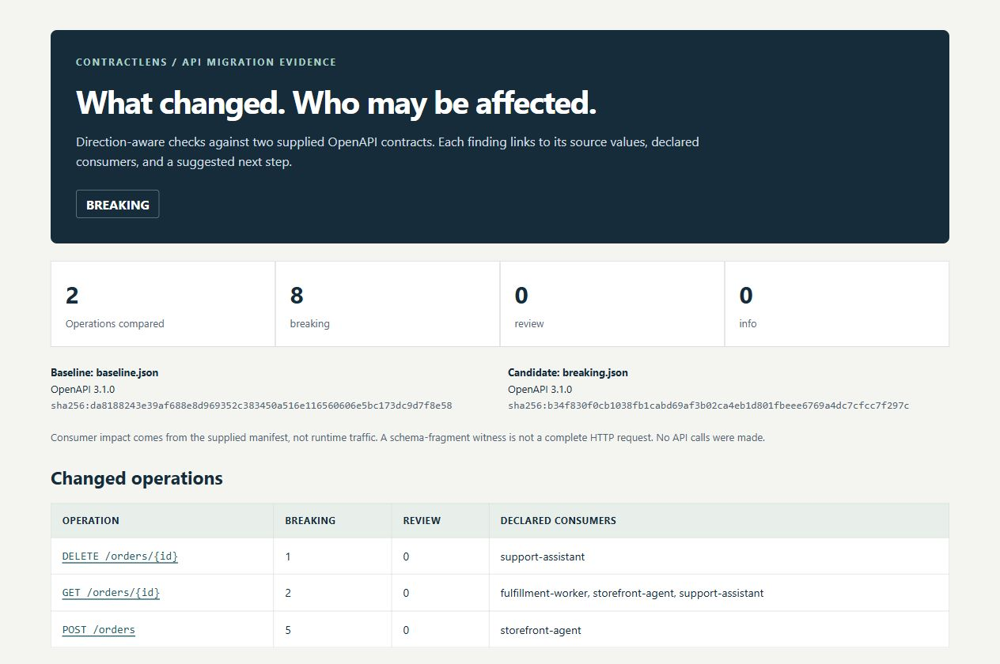

# ContractLens

[](https://github.com/Almeida96/contractlens/actions/workflows/ci.yml)
[](https://openjdk.org/projects/jdk/21/)
[](LICENSE)

Review API changes with evidence an agent can use. ContractLens compares two
OpenAPI contracts, identifies incompatibilities in a documented subset, and maps
findings to the consumers you declare. It runs locally in Java 21.

For example, removing `express` from a shipping enum can invalidate a request
an existing order agent sends. Adding `returned` to a response enum can break an
older consumer's exhaustive switch. ContractLens distinguishes those directions
and returns the original schema pointers, values, consumer names and suggested
checks. Supported scalar changes can include a verified schema-fragment witness.

The same evidence is available as JSON, Markdown, an offline HTML report, and
three read-only MCP tools. A [migration-review skill](skills/review-api-migration/SKILL.md)
shows how an agent can turn findings into a scoped migration plan.



## Try the complete example

Download the ZIP from [Releases](https://github.com/Almeida96/contractlens/releases),
extract it, and set `JAVA_HOME` to a Java 21 installation. From the extracted directory:

```sh
bin/contractlens demo --out orders-demo
```

PowerShell:

```powershell
.\bin\contractlens.bat demo --out orders-demo
```

Choose a directory that does not exist. Open `orders-demo/breaking/report.html`.
The demo compares three synthetic revisions against one baseline:

| Candidate | Result | What the example exercises |
| --- | --- | --- |
| `breaking.json` | `BREAKING` | Required tenant header, removed shipping option, tighter quantity limit, response changes and a removed operation |
| `compatible.json` | `COMPATIBLE` | An additional accepted shipping option and a new operation |
| `review.json` | `REVIEW` | A composed schema that the analyzer does not prove compatible |

This exercises the actual parser, rule engine, consumer mapping and report
writers. It does not call a model or a live API. No API key is needed.

## Compare an API change

```sh
bin/contractlens compare \
  --baseline api-before.yaml \
  --candidate api-after.yaml \
  --consumers consumers.json \
  --out release-review --gate
```

The command prints the complete JSON report. `--out` also writes `report.json`,
`report.md` and `report.html`. Existing output directories are refused.
JSON and YAML inputs are supported; remote references are never fetched.

| Exit | Meaning with `--gate` |
| --- | --- |
| `0` | No breaking or review findings within the supported checks |
| `2` | At least one breaking finding; review findings may also be present |
| `3` | No proven break, but findings need manual review |
| `1` | Invalid input or execution failure |

Without `--gate`, a completed comparison returns `0` regardless of its verdict.
Input and execution failures still return `1`. A compatible result is not a
guarantee of runtime behavior, generated SDK compatibility or release safety.

## Declare the integrations you maintain

The optional consumer manifest contains operation identities, not credentials:

```json
{
  "schemaVersion": 1,
  "consumers": [
    {"name": "storefront-agent", "operations": ["POST /orders", "GET /orders/{id}"]},
    {"name": "fulfillment-worker", "operations": ["GET /orders/{id}"]}
  ]
}
```

Matching uses the exact uppercase method and path template. This is declared
impact, not usage discovered from traffic or source code. An unmapped finding
has unknown consumer impact. A shared schema can produce separate findings for
each operation and request/response direction in which it is used.

## Let an agent inspect the evidence

Start the MCP server with a fixed pair of contracts and an optional manifest:

```sh
bin/contractlens mcp --baseline api-before.yaml --candidate api-after.yaml --consumers consumers.json
```

The server compares the inputs once and exposes an immutable report. Tools
cannot choose new files, run shell commands, call APIs or edit the contracts.

| Tool | Purpose |
| --- | --- |
| `review_summary` | Read the verdict, hashes, counts and analysis limits |
| `list_findings` | Page through findings; filter by severity, operation or declared consumer |
| `finding_evidence` | Retrieve a complete finding with original pointers, source values and any witness |

See [MCP setup](docs/mcp.md) for configuration and a real protocol smoke test
using the official Python MCP client. An example request for an agent is:

> Review the candidate Orders API for the storefront-agent. Cite the evidence
> for each migration task, distinguish proven breaks from manual checks, and
> identify what this comparison cannot establish.

The engine does not contain an LLM. Your connected client decides what evidence
to send to its model provider. Contract descriptions and examples remain
untrusted data; the included skill explicitly preserves that boundary.

## Scope

ContractLens accepts OpenAPI 3.0.x and 3.1.x documents and analyzes a bounded
subset: operations, request parameters and bodies, media types, and common
schema constraints. Request and response inclusion run in opposite directions.
Unsupported schema assertions, reference forms and changes that cannot be
established structurally produce `REVIEW` findings.

It is not a complete OpenAPI validator or a replacement for a broader API diff
suite. Its focus is traceable evidence, declared consumer impact and agent
integration. Read the [rule and support matrix](docs/rules.md) before using it
as a CI gate. The [data-handling guide](docs/data-handling.md) describes bounds,
local processing and what reports can reveal.

## Build and verify

Requires a JDK 21. The checked-in wrapper downloads Gradle 9.2.1 and verifies
its checksum. The initial build downloads pinned Maven dependencies.

```sh
./gradlew test installDist distZip --no-daemon
build/install/contractlens/bin/contractlens demo --out build/orders-demo
python checks/cli_smoke.py build/install/contractlens
```

On Windows, use `gradlew.bat` and the `.bat` launcher. For the MCP test:

```sh
python -m pip install 'mcp==1.26.0'
python checks/mcp_smoke.py --install-dir build/install/contractlens \
  --baseline examples/orders/baseline.json --candidate examples/orders/breaking.json \
  --consumers examples/orders/consumers.json
```

CI runs unit tests, the packaged demo, CLI decision/provenance checks and the
MCP client on Linux and Windows. [Architecture](docs/architecture.md),
[report fields](docs/report-format.md), [CI integration](docs/ci.md),
[validation](docs/validation.md), [contributing](CONTRIBUTING.md) and the
[changelog](CHANGELOG.md) cover maintenance.

MIT licensed. The engine and the included starter skill are both open source.
